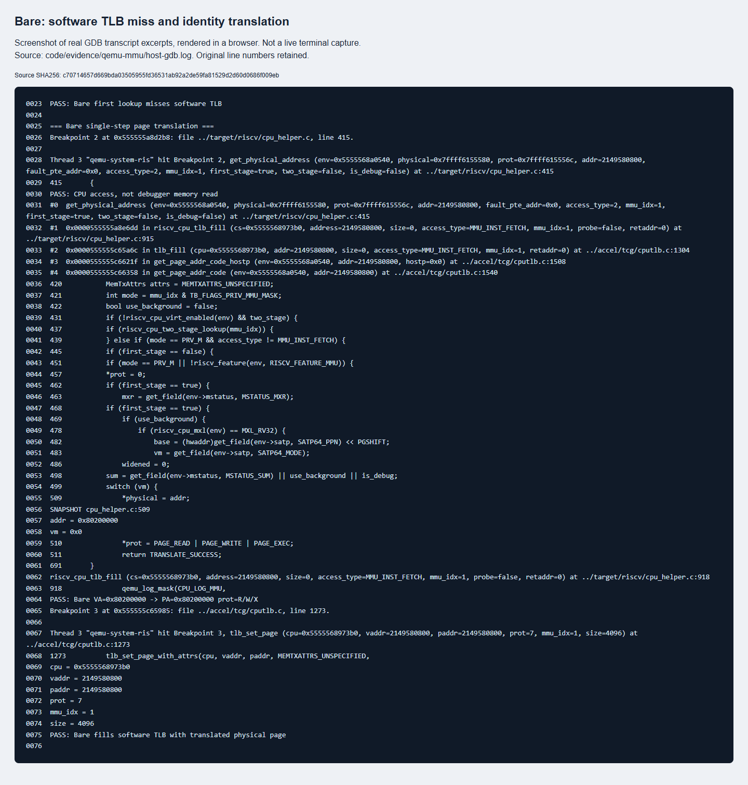
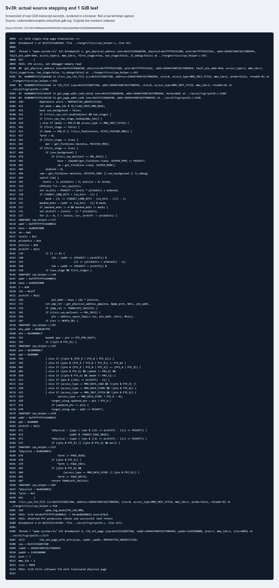
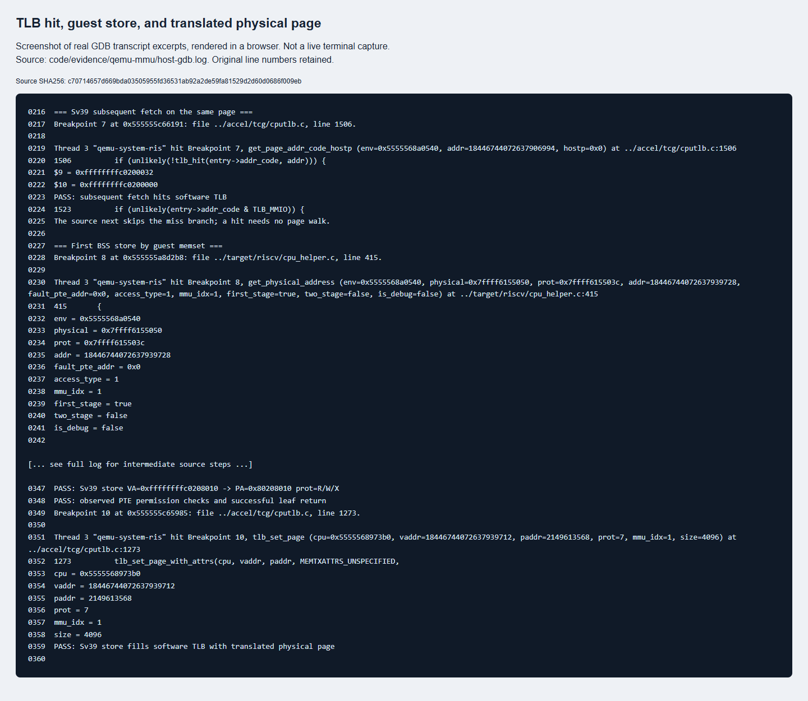

# C 分支任务：双 GDB 调试 QEMU 地址翻译

日期：2026-10-25。指导书参考：`lab2_4_qemu_mmu_debug.html`。本次实际编译并调试的是上游 QEMU 6.2.0，未修改其源码；指导书使用 4.1.1，两者行号及部分函数名不同。

## 1. 环境、构建和可复现入口

Ubuntu 22.04.1/WSL2 x86-64；原生 GDB 和 gdb-multiarch 均为 12.1。系统 QEMU 与调试版 QEMU 分开保存。调试版为 `--enable-debug`，`file` 确认 `with debug_info, not stripped`，构建目录在 `$HOME/.cache/oslab/qemu-6.2.0/build-debug`，未执行 make install。

源码来自 [download.qemu.org/qemu-6.2.0.tar.xz](https://download.qemu.org/qemu-6.2.0.tar.xz)，本次归档 SHA256 为：

```text
68e15d8e45ac56326e0b9a4afa8b49a3dfe8aba3488221d098c84698bca65b45
```

在 `lab2/code` 执行：

```bash
sudo apt-get install --no-install-recommends build-essential pkg-config python3 \
  libglib2.0-dev libpixman-1-dev zlib1g-dev curl xz-utils gdb gdb-multiarch
bash tools/build-debug-qemu.sh
make grade-source
```

已有其他路径时执行 `make grade-source QEMU_DEBUG=/absolute/path/to/qemu-system-riscv64`。源码断点按上游 6.2.0 定位；不能给脚本传入任意版本的剥离二进制并期望同样行号有效。

`qemu_mmu_debug.py` 由 nm 获取当前 kern_init 和 edata 地址，选临时本机端口，先启动原生 GDB，把 QEMU 作为被调试子进程，再启动客户机 gdb-multiarch。采用子进程方式避免 attach 被 ptrace 策略阻止，不修改系统安全配置。客户机在物理入口、高地址 C 入口、memset 和 run_selftests 停留；宿主在相应虚拟地址的翻译处单步。两个 GDB 均有日志，串口单独记录；完成后结束本脚本创建的进程组。

证据入口：[host-gdb.log](../code/evidence/qemu-mmu/host-gdb.log)、[guest-gdb.log](../code/evidence/qemu-mmu/guest-gdb.log)、[qemu.log](../code/evidence/qemu-mmu/qemu.log)。完整自动控制逻辑见 [qemu_host.py](../code/tools/qemu_host.py)。

## 2. 两层调试分别看什么

原生 GDB 的 `$pc` 是宿主 x86-64 指令地址，`env->satp` 等字段才是模拟的 RISC-V CPU 状态。gdb-multiarch 的 `$pc/$satp/$a0` 是客户机寄存器。宿主暂停会使客户机 GDB 等待，不能把这段等待误判为内核卡死。

手工对应操作是在宿主 `gdb --args` 中使用以下命令；QEMU 参数与自动脚本一致，在另一个终端用内核 ELF 连接其 GDB stub。地址应取本次内核的 nm 输出，下列数值来自本轮构建：

```gdb
set pagination off
handle SIGPIPE nostop noprint pass
break get_physical_address if addr == 0xffffffffc0200032 && !is_debug
run
bt 5
p/x env->satp
p/x addr
next
```

客户机调试入口可由 `make debug QEMU=...` 与 `make gdb` 建立；但采用这条路线时宿主要 attach 到已启动的 QEMU。自动脚本直接作为父调试器启动 QEMU，更易复现。其关键条件断点还包括 `accel/tcg/cputlb.c:1506` 的目标 addr、`tlb_set_page` 的目标虚拟页，以及 BSS 首次写入的 `access_type==1 && !is_debug`。

条件断点只选择目标地址，避免每次固件访问都停下。`is_debug=false` 排除了 GDB 自己读取内核符号、反汇编时产生的地址查询；否则很容易把调试器的查询当作 CPU 真正执行的访存。

## 3. 实际调用路径

取指的现场调用栈为：`cpu_exec` → `tb_lookup/tb_htable_lookup` → `get_page_addr_code` → `get_page_addr_code_hostp` → 软件 TLB 未命中 → `tlb_fill` → `riscv_cpu_tlb_fill` → `get_physical_address`。译址成功后继续进行 PMP 检查及 `tlb_set_page`，再返回取指路径。TLB 命中时不会走这段查页表分支。

实际数据写入路径另有现场栈：客户机 `memset` 中的 `sb` → TCG 生成代码 → `full_stb_mmu` → `store_helper` → `tlb_fill` → `riscv_cpu_tlb_fill` → `get_physical_address`。其中 store_helper 使用写权限对应的缓存项；不把取指路径当作所有 load/store 的唯一入口。TCG 生成代码的快路径也可能直接访问缓存，不必每次都进入 C helper。

| QEMU 6.2.0 源码位置 | 作用及分支 |
|---|---|
| `accel/tcg/cputlb.c:1506` | 取指比较 entry->addr_code 与 VA 页标记；miss 后先看 victim TLB，再 tlb_fill |
| `accel/tcg/cputlb.c:1922`、`:2321` | load_helper/store_helper 的读写缓存检查 |
| `target/riscv/cpu_helper.c:451` | M 模式且未被 MPRV 改变访问模式等情形，可直接 PA=addr |
| `cpu_helper.c:499` | 读取 satp.MODE，Bare 直接映射，Sv39 配置 3 层、9 位索引、8 字节 PTE |
| `cpu_helper.c:527` | 检查 VA 高位是否正确符号扩展 |
| `cpu_helper.c:537` | 逐层计算索引、PTE PA 并读 PTE；非叶子继续下一层 |
| `cpu_helper.c:593` | 校验 V、R/W/X 组合、U/S、superpage 对齐及访问权限 |
| `cpu_helper.c:628` | 必要时更新 A/D；本轮 A/D 已预置，未进入更新分支 |
| `cpu_helper.c:670` | 合成大页 PA 与返回访问权限 |
| `cpu_helper.c:939`、`cputlb.c:1273` | 成功后回填软件 TLB |

## 4. Sv39 单步查表：不是固定走满三层

客户机停在 kern_init 时：`pc=0xffffffffc0200032`、`sp=0xffffffffc0207000`、`satp=0x8000000000080207`。MODE=8、ASID=0、根 PPN=0x80207，所以根 PA=0x80207000。

宿主逐条 next，日志记录到如下真实变量：

```text
addr = 0xffffffffc0200032
base = 0x80207000
vm = 0x8, levels = 3, ptidxbits = 9, ptesize = 8
i = 0, ptshift = 18, idx = 511
pte_addr = 0x80207000 + 511*8 = 0x80207ff8
pte = 0x200000cf
ppn = 0x80000
*physical = 0x80200032
*prot = 7
```

Sv39 把地址分为 VPN[2]/VPN[1]/VPN[0]/offset。循环的三次上限对应这三个层级，ptshift 依次为 18、9、0；每次从当前页表基址加索引乘 8，读出一个 PTE。如果 V=1 且 R/W/X 全为零，PTE 是下一级表指针，令 base=PPN<<12 后继续。如果有 R 或 X，则命中叶子并检查权限、对齐；本次第一次循环已经是叶子，所以立即返回，不会读取第二、三层表。

`0xcf` 即 V/R/W/X/A/D，U/G 为零。PPN=0x80000 低 18 位为零，满足 1 GiB 大页的物理对齐。此处 PA 不是简单把 PPN 与 12 位 offset 拼接：还要将低两级 VPN 的 18 位纳入大页内偏移。QEMU 表达式为：

```c
physical = ((ppn | (vpn & ((1L << ptshift)-1))) << 12)
           | (addr & 0xfff);
```

因此 `0xffffffffc0200032` 映射到 `0x80200032`，与固定偏移换算相符。`prot=7` 是 QEMU 的读/写/执行权限表示，不是原始 PTE 的数值。

本次检查了权限条件实际经过的路径，没有故意注入非法 PTE；无效地址由客户机 GDB 的只读 walker 确认为 V=0。没有声称执行过完整三级 4 KiB 查表、权限缺页陷阱、动态取消映射或 A/D 原子更新测试。

## 5. 一条实际写内存指令

客户机在 memset 反汇编看到：

```text
a0 = 0xffffffffc0208010, a1 = 0, a2 = 0x481a0
0xffffffffc02031fa: addi a5,a5,1
0xffffffffc02031fc: sb   a1,-1(a5)
```

第一次循环 a5 先加一，再以 a5-1 写入，因此目标 VA 为 edata，即 `0xffffffffc0208010`。宿主命中 `get_physical_address` 条件断点，现场 `size=1`、`access_type=MMU_DATA_STORE`、`mmu_idx=1`、`is_debug=false`，调用栈包含 store_helper。单步得到同一根项 `0x200000cf`，PA=`0x80208010`；回填的页基址是 VA `0xffffffffc0208000` → PA `0x80208000`。客户机随后完成 BSS 清零、PMM 初始化和全组正常自测。

## 6. TLB miss、回填、hit 与 Bare 对比

第一次高地址取指在 `cputlb.c:1506` 看到 `entry->addr_code=0xffffffffffffffff`，与目标虚拟页不匹配，进入 miss 分支。页表翻译后 `tlb_set_page` 收到虚拟页 `0xffffffffc0200000`、物理页 `0x80200000`、prot=7、mmu_idx=1、size=4096。虽然客体 PTE 是 1 GiB 叶子，这次 QEMU 回填的缓存粒度是 4 KiB，不能混为同一层概念。

后续对同页的取指，addr 为 `0xffffffffc0200032`，entry->addr_code 为 `0xffffffffc0200000`。缓存页标记匹配；一次 next 从 1506 跳到 1523，绕过了页表查询和回填分支。该命中是实际观察结果，而不是“没再触发断点所以推测命中”。

Bare 对比选择 OpenSBI 刚进入 S 模式内核的 `0x80200000`，现场 satp=0、mmu_idx=1。仍先查询 QEMU 软件 TLB，并发生 miss；`get_physical_address` 在 MODE=Bare 分支直接设置 PA=VA、prot=7，然后进行 PMP 检查及软件 TLB 回填，完全没有读页表。这里并非用 M 模式快捷分支冒充 S 模式 Bare 的观察。

真实 CPU 的架构级 TLB 缓存地址翻译及权限，Bare 语义是不进行分页翻译；实现是否在内部继续缓存，ISA 不要求统一。QEMU 的软件 TLB 同时用于模拟访问和加速客户机地址到宿主 RAM 的定位，entry 的 addend 可把 VA 快速转换为宿主指针；因此 Bare 下使用软件 TLB 不代表硬件规范要求 Bare 查页表。QEMU 的软件 TLB miss、客户机页表遍历、宿主操作系统对 QEMU 进程的页表管理也是三种不同事情。

## 7. 截图与证据来源

下图是 Playwright 对真实 GDB 日志摘录页面的浏览器截图，**不是现场终端截图**。HTML 由 `tools/render_debug_evidence.py` 生成，保留原日志行号和 SHA256，省略段落明确标记；完整原始日志可交叉核对。截图只用于阅读，不能替代重新运行脚本。







## 8. 排错细节与 AI 学习记录

最先遇到的“启动没反应”来自旧 boot.gdb：高地址 kern_entry 符号在分页前不能作为实际执行入口断点。改为物理入口断点，再在高地址 kern_init 验证切换，才能区分是断点错误还是内核错误。

另一个容易误解的地方是“Sv39 有三层，就应看到循环三次”。AI 帮助定位 R/W/X 叶子判断，现场 i=0 即返回，说明大页会提前结束，不能为了报告凑出三层记录。还需区分 PTE 低位和 QEMU prot、内核 VA 和根表 PA、客户机 PA 和宿主指针。

宿主 GDB 设置 SIGPIPE 不停留，避免 stub 连接变化时信号打断观察；本次未专门破坏连接来复现 SIGPIPE，也没有把它写成实际出现的错误。完整的 C 提问、修正过程及 AI/人工边界见 [AI 协作记录](ai-collaboration.md)。
